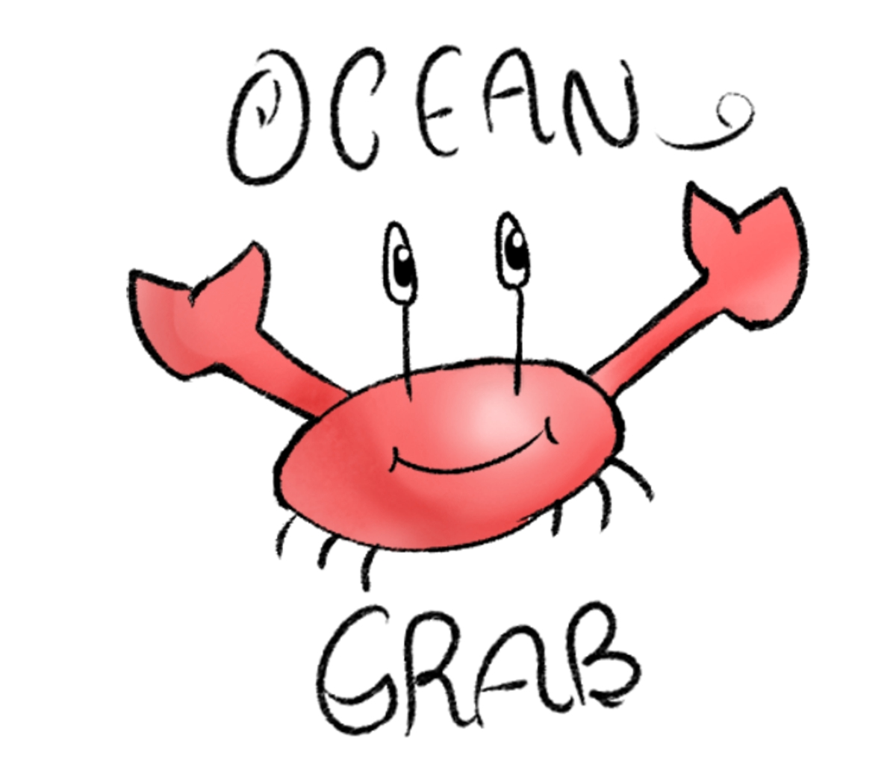
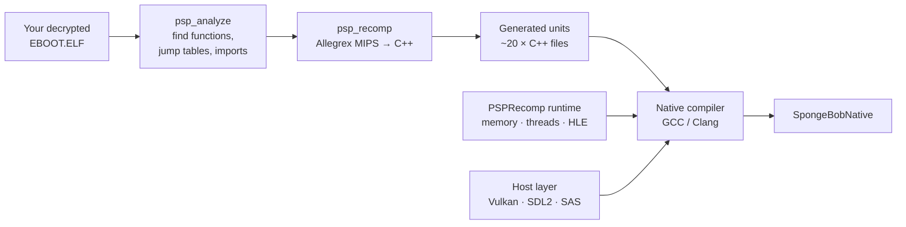

<div align="center">



**SpongeBob's Truth or Square** (PSP · `ULUS-10478`), running natively on PC.<br>
The game's MIPS code is translated to C++ ahead of time and compiled for your CPU. No emulator, no JIT.

[](https://github.com/santiagoarce-rgb/OceanCrab/actions/workflows/ci.yml)


[](LICENSE)

[Status](#status) · [Enhancements](#enhancements) · [How it works](#how-it-works) · [Getting started](#getting-started) · [Controls](#controls) · [Roadmap](#roadmap) · [Contributing](CONTRIBUTING.md)

</div>

---

## Why

Ocean Crab takes your own decrypted copy of the game and turns its executable into a standalone native program. A small runtime stands in for the PSP's operating system and hardware. Graphics go through Vulkan, input and audio through SDL2.

The long-term goal is a full PC port in the spirit of community projects such as Ship of Harkinian: enhancements, quality-of-life options, mod support and, eventually, **online co-op**.

> [!IMPORTANT]
> This repository contains **no game code or assets**. You need a legally obtained copy of the game and must decrypt the EBOOT yourself. See [Legal](#legal).

## Status

> [!NOTE]
> **Completable and enhanced.** The game boots, plays its Bink videos natively with sound and can be played from New Game to the ending credits, minigames included. On top of that it already renders well beyond the PSP: up to 6x internal resolution (1080p and more), MSAA, anisotropic filtering, and a draw distance up to 64x the original, all from an in-game **F1 menu**.

| Area | | Notes |
|---|:---:|---|
| Boot | ✅ | EBOOT loading and relocation, `module_start`, worker threads |
| Threading | ✅ | Virtual scheduler with cooperative yield, kernel mutexes with timeouts; game threads switch without deadlocks |
| Rendering | ✅ | GE display lists translated to Vulkan; 2D and 3D, texture-matrix animation (water, lava, skies), soft alpha blending, high internal resolutions |
| Performance | ✅ | Pipelined GPU frames and cached readback: full speed at 1080p with 8x MSAA on a GTX 1650 laptop |
| Audio | ✅ | Music and sound effects through `sceAudio` + SAS mixer; movie audio through `sceAudioOutput2` |
| Input | ✅ | Keyboard and gamepads (SDL2) |
| File I/O | ✅ | `sceIo*` streaming from your extracted `PSP_GAME/USRDIR` |
| Menus | ✅ | Main menu, Story Mode, Credits, Options |
| Gameplay | ✅ | Playable start to finish (levels, boss, ending, minigames) |
| VFPU | 🚧 | Translated by the code generator; the instructions the Bink decoder uses all run. Remaining unlowered sites are being audited |
| Bink videos | ✅ | Decoded natively, with correct colors and audio |

### Current investigation

- **Minor texture glitches.** A few townsfolk fish in the hub still have wrong textures.
- **Saving.** Progress is not saved yet: the Memory Stick is emulated without writing to disk. This is the next priority.
- **CPU cost.** Vertex processing (~5 ms per frame) is the next optimization target; it grows with very long draw distances.

## Enhancements

Press **F1** in game. Settings are saved to `SpongebobNative.ini` next to the executable.

| Option | | What it does |
|---|:---:|---|
| Internal resolution | restart | 1x (480x272, PSP) up to 6x (2880x1632) |
| Anti-aliasing (MSAA) | restart | Off, 2x, 4x, 8x |
| Anisotropic filtering | restart | Off up to 16x |
| **Draw distance** | live | 1x (original) up to **64x**. Pushes out the far plane, the fog and the engine's entity culling, so distant scenery, objects and enemies stay visible. The PSP hid a lot of level detail behind fog |
| Smooth scaling, aspect ratio, integer scaling | live | How the image is fitted to the window |
| Fullscreen (F11), FPS counter | live | |

The menu also shows which GPU is in use (a discrete GPU is preferred on hybrid laptops).

**Cheats** (F1 → Cheats), handy for testing: infinite health, infinite lives, moon jump (hold **J**), turbo (hold **Tab** to run unthrottled), and save / load position (**F5** / **F7**).

## How it works



- **Static recompilation, not emulation.** The analyzer discovers about 118,000 functions in the full corpus, including jump-table targets and functions reached only through pointers. The code generator emits them as C++ functions registered at their guest addresses.
- **Indirect control flow.** Jump tables and function pointers resolve at run time through a dispatcher. Generated units chain directly to each other when it is safe.
- **HLE kernel.** PSP system calls (`sceKernel*`, `sceIo*`, `sceDisplay*`, `sceGe*`, `sceAudio*`, `sceCtrl*`, `sceUmd*`, …) are implemented natively by NID.
- **Native overrides.** Any guest function can be replaced with hand-written C++ via `Runtime::register_function`. This is how fixes, enhancements and, gradually, understood game code enter the port.
- **Understanding the game.** [`tools/symbolize`](tools/symbolize/README.md) names functions and classes from the binary alone (GCC RTTI, vtables, debug strings, Lua binding tables): 399 classes and over 3,000 functions so far. Crash dumps and the engine log print these names. The player, camera and enemy layouts live in [`profiles/spongebob/host/game/`](profiles/spongebob/host/game/), mapped by recording live play sessions.

Read more in [`docs/ARCHITECTURE.md`](docs/ARCHITECTURE.md).

## Getting started

### Requirements

- CMake 3.20+, Ninja, and a C++20 compiler (GCC 12+ or Clang 15+)
- Vulkan headers and loader, SDL2, `glslangValidator`

<details>
<summary><b>Arch Linux</b></summary>

```bash
sudo pacman -S base-devel cmake ninja vulkan-devel glslang sdl2-compat spirv-tools
```
</details>

<details>
<summary><b>Debian / Ubuntu</b></summary>

```bash
sudo apt install build-essential cmake ninja-build glslang-tools spirv-tools \
    libvulkan-dev vulkan-tools libsdl2-dev
```
</details>

### 1. Prepare your game files

```
profiles/spongebob/original/
├── ULUS10478_EBOOT.ELF      ← your decrypted EBOOT
└── PSP_GAME/                ← extracted from your UMD image
    └── USRDIR/ …
```

### 2. Build the tools

```bash
git clone https://github.com/santiagoarce-rgb/OceanCrab.git
cd OceanCrab
cmake -S . -B out/crab -G Ninja -DCMAKE_BUILD_TYPE=Release -DPSPRECOMP_PROFILE=spongebob -DPSPRECOMP_NATIVE_CPU=ON
cmake --build out/crab -j"$(nproc)"
```

### 3. Generate the AOT corpus from your EBOOT

```bash
./out/crab/psp_recomp profiles/spongebob/original/ULUS10478_EBOOT.ELF \
    --auto profiles/spongebob/generated 0x08804000 0x20000
```

The corpus is about 56 MB of C++ in 20 units. It is derived from your game binary, so it is git-ignored and every user generates their own.

### 4. Build the game

```bash
cmake --build out/crab -j"$(nproc)"
```

The first build of the generated units takes a while (about 12 minutes on a 16-thread laptop CPU). `PSPRECOMP_NATIVE_CPU=ON` tunes the build for your CPU; leave it off if you want to share the binary.

### 5. Play

```bash
PSPRECOMP_AUDIO=1 ./out/crab/profiles/spongebob/SpongeBobNative
```

| Variable | Purpose |
|---|---|
| `PSPRECOMP_AUDIO=1` | Enable audio output |

Press **F1** in game to open the [enhancements menu](#enhancements). **F11** toggles fullscreen. Closing the window quits cleanly.

Display, rendering and timing options live in [`profiles/spongebob/config/SpongeBobNative.ini`](profiles/spongebob/config/SpongeBobNative.ini) (copy it next to the executable as `SpongebobNative.ini`, or point `PSPRECOMP_CONFIG` at it). Every CMake option and environment variable, including the debugging ones, is documented in [`docs/ENVIRONMENT.md`](docs/ENVIRONMENT.md).

## Controls

| PSP | Keyboard / mouse | Gamepad |
|---|---|---|
| Stick | W A S D (Left Alt = walk) | Left stick |
| D-pad | Arrow keys | D-pad |
| ✕ (jump) | Space | A |
| □ (spin slap) | Shift | X |
| △ (spatula) | F or Enter | Y |
| ○ (water balloon) | Left mouse button | B |
| L (recenter camera) | H or middle mouse button | LB / LT |
| R (hold + stick: orbit camera) | Right mouse button | RB / RT |
| Start / Select | Esc / V | Start / Back |

## Roadmap

| Phase | | Goal |
|---|:---:|---|
| Bring-up | ✅ | Boot, scheduler, timers, file I/O, rendering, audio, input, **playable start to finish** |
| **1 · Correctness** | 🚧 | Done: VFPU translation, native Bink video and audio, real heap sizing, texture matrices, soft alpha, no workarounds. Left: audit the remaining unlowered VFPU sites, last texture glitches |
| 2 · Understanding | 🚧 | Done: automatic symbol map, Lua API of the level scripts (39 libraries), player/camera/enemy/boss structures. Left: level loader, AI, moving logic into native C++ overrides |
| 3 · Enhancements | 🚧 | Done: F1 menu, high-resolution rendering, MSAA, draw distance up to 64x. Left: widescreen, 60 FPS, post-processing, texture replacement, controller remapping, Lua mod support |
| 4 · Co-op | 🚧 | Done: a game character driven from native code (puppet test). Left: networking (Anchor-style relay), remote players, shared progress, then enemies and bosses |
| 5 · Platforms | 🔭 | Windows and macOS builds |

## Project layout

```
include/psprecomp/, src/     PSPRecomp framework (decoder, ELF, memory, runtime, analysis)
tools/                       psp_analyze, psp_recomp (code generator), dump_function, dump_image, Ghidra scripts
tools/symbolize/             Automatic symbolization and play-session analysis (phase 2)
profiles/spongebob/host/     Game profile: HLE, Vulkan GE renderer, SDL2, audio, F1 menu
profiles/spongebob/host/game/ Reverse-engineered game structures (player, camera, enemies)
profiles/spongebob/config/   Runtime configuration
profiles/spongebob/analysis/ Function, seed and import reports and the symbol map for ULUS-10478
tests/                       Framework test suite
docs/                        Architecture, profile guide, configuration reference
```

## Contributing

Contributions are welcome, especially **auditing the remaining unlowered VFPU sites** in the generated corpus, CPU performance, the last rendering glitches, and reverse engineering game structures (phase 2). The debugging tools are listed in [`docs/ENVIRONMENT.md`](docs/ENVIRONMENT.md): frame profiler, texture skip/dump, object recording, and **input record/replay** (the game is deterministic, so a recorded play session replays exactly in a headless run, reaching any level). Read [`CONTRIBUTING.md`](CONTRIBUTING.md) first. It covers the commit style, the rule about never committing generated code or game data, and how to propose code generator changes.

General-purpose fixes to the framework are intended to go back upstream to PSPRecomp.

## Legal

Ocean Crab does **not** include any copyrighted game code, assets, ISOs or executables, and it contains no decryption code. You must own the game and prepare its files yourself. The generated AOT corpus is derived from your own executable and is never distributed.

*SpongeBob SquarePants* and all related properties are trademarks of their respective owners. This is an unofficial fan project made for preservation and education. It is not affiliated with or endorsed by the rights holders.

## Credits

Ocean Crab stands on the shoulders of:

- [**PSPRecomp**](https://github.com/jessicanataliagta/PSPRecomp): the recompilation framework
- [**lcs-recomp**](https://github.com/elmasas/lcs-recomp): Vulkan, SDL2 and SAS host layer
- [**Yakumo**](https://github.com/TeamGDB/Yakumo): reference for PSP static recompilation
- [**Dear ImGui**](https://github.com/ocornut/imgui): the F1 menu
- [**Ship of Harkinian**](https://github.com/HarbourMasters/Shipwright), [**Dusklight**](https://github.com/TwilitRealm/dusklight), Crests of Courage and Anchor: inspiration for the menu and the co-op design

See [`THIRD_PARTY.md`](THIRD_PARTY.md) for licenses.

## License

[MIT](LICENSE)
