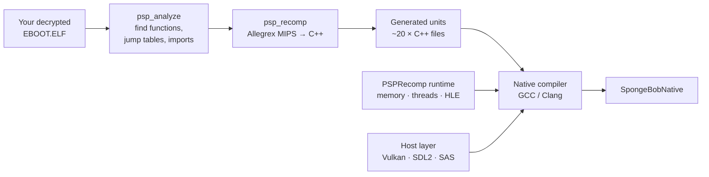

<div align="center">


**SpongeBob's Truth or Square** (PSP · `ULUS-10478`), running natively on PC.<br>
The game's MIPS code is translated to C++ ahead of time and compiled for your CPU. No emulator, no JIT.

[](https://github.com/santiagoarce-rgb/OceanCrab/actions/workflows/ci.yml)


[](LICENSE)

[Status](#status) · [How it works](#how-it-works) · [Getting started](#getting-started) · [Roadmap](#roadmap) · [Contributing](CONTRIBUTING.md)

</div>

---

## Why

Ocean Crab takes your own decrypted copy of the game and turns its executable into a standalone native program. A small runtime stands in for the PSP's operating system and hardware. Graphics go through Vulkan, input and audio through SDL2.

The long-term goal is a full PC port in the spirit of community projects such as Ship of Harkinian: enhancements, quality-of-life options, mod support and, eventually, **online co-op**.

> [!IMPORTANT]
> This repository contains **no game code or assets**. You need a legally obtained copy of the game and must decrypt the EBOOT yourself. See [Legal](#legal).

## Status

> [!NOTE]
> **Gameplay reached.** The game boots, plays its Bink videos natively, and **New Game** loads the first level (the Krusty Krab hub) with the HUD, characters and working input.

| Area | | Notes |
|---|:---:|---|
| Boot | ✅ | EBOOT loading and relocation, `module_start`, worker threads |
| Threading | ✅ | Virtual scheduler with cooperative yield; game threads switch without deadlocks |
| Rendering | ✅ | GE display lists translated to Vulkan; 2D and 3D |
| Audio | ✅ | Music and sound effects through `sceAudio` + SAS mixer |
| Input | ✅ | Keyboard and gamepads (SDL2) |
| File I/O | ✅ | `sceIo*` streaming from your extracted `PSP_GAME/USRDIR` |
| Menus | ✅ | Main menu, Story Mode, Credits, Options |
| Gameplay | 🚧 | Hub and first level load and are playable; attacking crashes; one object model is missing |
| VFPU | 🚧 | Translated by the code generator; the instructions the Bink decoder uses all run. Remaining unlowered sites are being audited |
| Bink videos | 🚧 | Intro videos decode and play through to the title screen; colors are wrong (luma only) |

### Current investigation

- **Bink colors.** The statically linked Bink decoder runs natively, but video frames have no blue channel (only red/green). The YUV → RGB path, or the video texture format in the GE, is under investigation.
- **Bink audio.** The decoder's audio thread exits right after it starts, so videos are silent.
- **Attack crash.** Pressing attack in the first level (robot fight) crashes.
- **Game speed.** Gameplay runs faster than real time; frame pacing is not locked to the PSP's 60 Hz VBlank yet.

`PSPRECOMP_SKIP_BIK=1` still replaces the video pipeline with stubs (a fake Bink header and a "finished" Movie object). It is no longer needed to reach the title screen, and the plan is to remove it.

## How it works



- **Static recompilation, not emulation.** The analyzer discovers about 118,000 functions in the full corpus, including jump-table targets and functions reached only through pointers. The code generator emits them as C++ functions registered at their guest addresses.
- **Indirect control flow.** Jump tables and function pointers resolve at run time through a dispatcher. Generated units chain directly to each other when it is safe.
- **HLE kernel.** PSP system calls (`sceKernel*`, `sceIo*`, `sceDisplay*`, `sceGe*`, `sceAudio*`, `sceCtrl*`, `sceUmd*`, …) are implemented natively by NID.
- **Native overrides.** Any guest function can be replaced with hand-written C++ via `Runtime::register_function`. This is how fixes, enhancements and, gradually, understood game code enter the port.

Read more in [`docs/ARCHITECTURE.md`](docs/ARCHITECTURE.md).

## Getting started

### Requirements

- CMake 3.20+, Ninja, and a C++20 compiler (GCC 12+ or Clang 15+)
- Vulkan headers and loader, SDL2, `glslangValidator`

<details>
<summary><b>Arch Linux</b></summary>

```bash
sudo pacman -S base-devel cmake ninja vulkan-devel glslang sdl2-compat spirv-tools
```
</details>

<details>
<summary><b>Debian / Ubuntu</b></summary>

```bash
sudo apt install build-essential cmake ninja-build glslang-tools spirv-tools \
    libvulkan-dev vulkan-tools libsdl2-dev
```
</details>

### 1. Prepare your game files

```
profiles/spongebob/original/
├── ULUS10478_EBOOT.ELF      ← your decrypted EBOOT
└── PSP_GAME/                ← extracted from your UMD image
    └── USRDIR/ …
```

### 2. Build the tools

```bash
git clone https://github.com/santiagoarce-rgb/OceanCrab.git
cd OceanCrab
cmake -S . -B out/crab -G Ninja -DCMAKE_BUILD_TYPE=Release -DPSPRECOMP_PROFILE=spongebob
cmake --build out/crab -j"$(nproc)"
```

### 3. Generate the AOT corpus from your EBOOT

```bash
./out/crab/psp_recomp profiles/spongebob/original/ULUS10478_EBOOT.ELF \
    --auto profiles/spongebob/generated 0x08804000 0x20000
```

The corpus is about 56 MB of C++ in 20 units. It is derived from your game binary, so it is git-ignored and every user generates their own.

### 4. Build the game

```bash
cmake --build out/crab -j"$(nproc)"
```

The first build of the generated units takes a while.

### 5. Play

```bash
PSPRECOMP_SKIP_BIK=1 PSPRECOMP_AUDIO=1 ./out/crab/profiles/spongebob/SpongeBobNative
```

| Variable | Purpose |
|---|---|
| `PSPRECOMP_SKIP_BIK=1` | Skip the Bink videos with stub objects (workaround, being phased out) |
| `PSPRECOMP_AUDIO=1` | Enable audio output |

Display, rendering and timing options live in [`profiles/spongebob/config/SpongeBobNative.ini`](profiles/spongebob/config/SpongeBobNative.ini). Every CMake option and environment variable, including the debugging ones, is documented in [`docs/ENVIRONMENT.md`](docs/ENVIRONMENT.md).

## Roadmap

| Phase | | Goal |
|---|:---:|---|
| Bring-up | ✅ | Boot, scheduler, timers, file I/O, rendering, audio, input, **main menu** |
| **1 · Correctness** | 🚧 | VFPU translation in the code generator; replace the video and allocation workarounds with real fixes |
| 2 · Understanding | 🔜 | Name functions and structures (player, actors, camera, level loader) and move them to native C++ overrides |
| 3 · Enhancements | 🔜 | In-game options menu, widescreen, high-resolution rendering, 60 FPS, controller remapping, mod support |
| 4 · Co-op | 🔭 | Online co-op: sync remote players as in-world puppets, then shared progress |
| 5 · Platforms | 🔭 | Windows and macOS builds, performance work |

## Project layout

```
include/psprecomp/, src/     PSPRecomp framework (decoder, ELF, memory, runtime, analysis)
tools/                       psp_analyze, psp_recomp (code generator), dump_function, Ghidra export
profiles/spongebob/host/     Game profile: HLE, Vulkan GE renderer, SDL2, audio
profiles/spongebob/config/   Runtime configuration
profiles/spongebob/analysis/ Function, seed and import reports for ULUS-10478
tests/                       Framework test suite
docs/                        Architecture, profile guide, configuration reference
```

## Contributing

Contributions are welcome, especially **VFPU translation** in `tools/codegen_main.cpp` and reverse engineering of game structures. Read [`CONTRIBUTING.md`](CONTRIBUTING.md) first. It covers the commit style, the rule about never committing generated code or game data, and how to propose code generator changes.

General-purpose fixes to the framework are intended to go back upstream to PSPRecomp.

## Legal

Ocean Crab does **not** include any copyrighted game code, assets, ISOs or executables, and it contains no decryption code. You must own the game and prepare its files yourself. The generated AOT corpus is derived from your own executable and is never distributed.

*SpongeBob SquarePants* and all related properties are trademarks of their respective owners. This is an unofficial fan project made for preservation and education. It is not affiliated with or endorsed by the rights holders.

## Credits

Ocean Crab stands on the shoulders of:

- [**PSPRecomp**](https://github.com/jessicanataliagta/PSPRecomp): the recompilation framework
- [**lcs-recomp**](https://github.com/elmasas/lcs-recomp): Vulkan, SDL2 and SAS host layer
- [**Yakumo**](https://github.com/TeamGDB/Yakumo): reference for PSP static recompilation

See [`THIRD_PARTY.md`](THIRD_PARTY.md) for licenses.

## License

[MIT](LICENSE)
